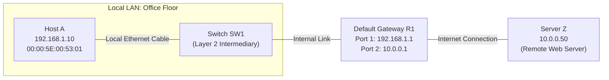
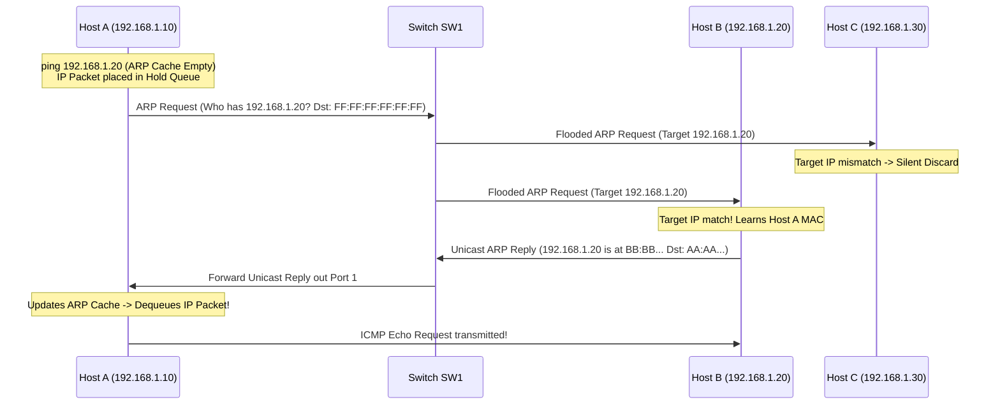

# Networking Track: Mentor Mode Curriculum Specification (Modules 1 to 5)

> **Document Version:** 2.1.0  
> **Status:** Approved Pedagogical Specification  
> **Location:** `docs/networking/NETWORKING_MENTOR_CURRICULUM_M1_M5.md`  
> **Audited against:** `main` @ `98ba35c`, `NETWORKING_MODULE_4_SUBNETTING_PILOT_SPEC.md`, `NETWORKING_MODULE_5_ARP_PILOT_SPEC.md`, and `NETWORKING_STATUS_AND_DECISION_RECORD.md`  
> **Companion Document:** `docs/networking/NETWORKING_MENTOR_MODE_SPEC.md` (Runtime Architecture Contract)

---

## 1. Pedagogical Standards & Mathematical Invariants

1. **Third Way Assessment:** Zero free-text input, zero LLM grading, zero 2-option guessable 50/50 predictions. Every prediction beat requires:
   - $\ge 3$ distinct options with targeted misconception explanations.
   - A paired causal "Why" selector explaining the underlying networking law.
2. **5-Stage Cognitive Fading:** Strictly adheres to:
   $$\text{Stage 1 (Observe)} \longrightarrow \text{Stage 2 (Complete)} \longrightarrow \text{Stage 3 (Perform)} \longrightarrow \text{Stage 4 (Transfer)} \longrightarrow \text{Stage 5 (Diagnose)}$$
3. **Active Cadence Rule:** No more than 2 consecutive passive beats (`say`/`point`) before a mandatory student interaction (`do`, `predict`, or `select`).
4. **Block Increment Formula (Mathematically Generalized):**
   For any prefix $p \in [1, 32]$:
   $$\text{Bit index in active octet } k = ((p - 1) \pmod 8) + 1$$
   $$\text{Remaining host bits in active octet } H_{\text{active}} = 8 - k$$
   $$\text{Block Increment} = 2^{H_{\text{active}}} = 2^{(8 - k)}$$
   *(Flawless for all boundaries: $/8, /16, /24, /32 \implies k=8, H=0, \text{Increment}=1$; $/22 \implies k=6, H=2, \text{Increment}=4$; $/26 \implies k=2, H=6, \text{Increment}=64$.)*
5. **Valid EUI-48 MAC Invariant:** All MAC addresses adhere to the RFC 7042 documentation range (`00:00:5E:00:53:xx`) or standard EUI-48 unicast (`02:00:00:00:00:xx` / `AA:AA:AA:AA:AA:AA`), matching `/^([0-9A-Fa-f]{2}[:-]){5}([0-9A-Fa-f]{2})$/`.
6. **RFC Accuracy & Layer Boundaries:**
   - Ethernet Frame Check Sequence (FCS) is calculated via 32-bit CRC (displayed dynamically by `EthernetFrameInspector`).
   - Slicing data into $\le 1500$-byte chunks is performed by the sender's operating system network stack (L4 TCP MSS / L3 IP fragmentation), not raw Ethernet hardware.
   - Module 2 is strictly limited to Layer 2 mechanisms (Jumbo frames / MTU mismatch between NIC and Switch). Path MTU Discovery and ICMP Type 3 Code 4 are deferred to diagnostics in Module 14.

---

## 2. Module 1: The End-to-End Communication Journey
*Identity:* `net-01` | *Milestone 1* | *Focus: Endpoints vs. Intermediaries, L2 vs. L3 Traversal, Encapsulation*  
*Grading Policy:* Non-graded Discovery Mode (Orientation) with "Preview: Deep-dive in Module X" badges.



### 2.1 Stage 1 — Observe (The Discovery Walkthrough)
- **Beat 1 (`point`):** Reveal `Host A` on canvas. Trainer: *"Meet `Host A`. It runs applications that generate data. Devices that originate or terminate data are {{term:endpoints}}."*
- **Beat 2 (`point`):** Reveal `Server Z`. Trainer: *"Across the internet sits `Server Z`. It serves web pages. It is also an endpoint."*
- **Beat 3 (`do`):** Action prompt: Click preset chip `[Select Payload: HTTP GET /index.html]`.
- **Beat 4 (`point`):** Reveal `Switch SW1` and `Router R1`. Trainer: *"In between sit `Switch SW1` and `Router R1`. They don't generate data—they forward it. They are {{term:intermediaries}}."*
- **Beat 5 (`do`):** Click `[Package Data]`. Encapsulation Stepper animates:
  1. Layer 4 Transport: Wraps request in TCP header (`Dst Port 80`) $\implies$ **Segment**.
  2. Layer 3 Network: Wraps segment in IP header (`Src: 192.168.1.10 ➔ Dst: 10.0.0.50`) $\implies$ **Packet** *(Preview: Deep-dive in Module 4)*.
  3. Layer 2 Data Link: Wraps packet in Ethernet frame (`Dst MAC: Router R1`, FCS trailer) $\implies$ **Frame** *(Preview: Deep-dive in Module 2)*.

### 2.2 Stage 2 — Complete (Guided Header Traversal)
- **Beat 6 (`do`):** Click `[Step Hop: Host A ➔ Switch SW1 ➔ Router R1]`.
- **Beat 7 (`predict`):** 3-choice prediction + causal why:
  - *"As the frame crosses Router R1 toward Server Z, what changes?"*
    1. The Source and Destination IP addresses change. *(Misconception: confusing L3 routing with NAT)*
    2. The Layer 2 MAC addresses are rewritten for the next link, while the Layer 3 IPs remain intact. *(Correct)*
    3. The TCP port numbers are stripped.
  - *Why Selector:*
    1. Layer 3 IP represents end-to-end destination, while Layer 2 MAC represents hop-by-hop physical delivery. *(Correct)*
    2. Routers cannot read IP addresses.
    3. Ethernet cables require IP addresses to change every 10 meters.

### 2.3 Stage 3 — Perform (Independent Device Role Classification)
- Learner categorizes 4 devices in an unassisted enterprise topology:
  - PostgreSQL Database Server $\implies$ **Endpoint**
  - 24-Port Access Switch $\implies$ **Intermediary**
  - Core Edge Router $\implies$ **Intermediary**
  - Mobile Smartphone $\implies$ **Endpoint**

### 2.4 Stage 4 — Transfer (The Remote Delivery Boundary)
- **Scenario:** Host A sends traffic to Local Host B (`192.168.1.20`) vs. Remote Server Z (`10.0.0.50`).
- **Prediction:** *"What Destination MAC must Host A place on the Ethernet frame when transmitting to remote Server Z?"*
  1. Server Z's MAC address. *(Classic Misconception: Layer 2 frames cannot cross routers)*
  2. The Default Gateway Router R1's MAC address. *(Correct)*
  3. The Broadcast MAC `FF:FF:FF:FF:FF:FF`.
- *Why Selector:* Because local Layer 2 frames terminate at the router boundary; the router must receive the frame to forward the inner IP packet across the WAN.

### 2.5 Stage 5 — Diagnose (Discovery Ticket #101: "The Silent Link")
- *Status:* Non-graded discovery challenge.
- *Symptom:* Host A cannot transmit frames to Switch SW1. Port 1 link LED is dark.
- *Diagnostic Step:* Inspect physical link $\implies$ Cable unplugged at Switch Port 1.
- *Declarative Fix:* `action: 'set-link', target: 'port-1', value: 'connected'`.
- *Verification:* Link LED lights green $\implies$ Test HTTP GET frame traverses to Router R1.

---

## 3. Module 2: Links, Interfaces & Ethernet Framing
*Identity:* `net-02` | *Milestone 1* | *Focus: Link States, 48-bit MACs, MTU Boundaries, 32-bit CRC-32*

### 3.1 Stage 1 — Observe (The Frame Anatomy & 1500-byte MTU)
- **Beat 1 (`point`):** Reveal Host A's NIC. Spotlight MAC `00:00:5E:00:53:01`.
- **Beat 2 (`say`):** Trainer: *"Your network interface card has a 48-bit {{term:mac-address}}. Manufacturers burn a default into the chip, but modern operating systems can randomize it for privacy."*
- **Beat 3 (`do`):** Action prompt: Select 3,500-byte data payload. Click `[Pass to OS Network Stack]`.
- **Beat 4 (`point`):** Observe the OS network stack slice the stream into discrete frames so that no frame payload exceeds the 1500-byte {{term:mtu}}:
  - Frame 1: 1500-byte payload + 18-byte L2 header/trailer = 1518 total bytes.
  - Frame 2: 1500-byte payload + 18-byte L2 header/trailer = 1518 total bytes.
  - Frame 3: 500-byte payload + 18-byte L2 header/trailer = 518 total bytes.
- **Beat 5 (`do`):** Click `[Transmit Frame 1 with Noise ⚡]`. An electrical burst inverts bit 240.
- **Beat 6 (`point`):** The receiving NIC calculates CRC-32 via `EthernetFrameInspector`. Telemetry shows calculated CRC $\ne$ received FCS trailer. Result: **Silent hardware drop**.

### 3.2 Stage 2 — Complete (Frame Header Construction)
- Learner populates fields in an Ethernet II Frame:
  - Dest MAC (6 bytes) $\to$ Source MAC (6 bytes) $\to$ EtherType (`0x0800` IPv4) $\to$ Payload (46–1500 bytes) $\to$ FCS (4 bytes CRC-32).

### 3.3 Stage 3 — Perform (FCS & Integrity Forensics)
- 3 captured frame traces presented without hints:
  - Trace 1: 60 bytes total $\implies$ Runt frame (padded below 64-byte minimum).
  - Trace 2: 1518 bytes, valid CRC $\implies$ Valid Ethernet II frame.
  - Trace 3: 1518 bytes, CRC mismatch $\implies$ Corrupted frame dropped at Layer 2.

### 3.4 Stage 4 — Transfer (Layer 2 Jumbo Frame Mismatch)
- **Scenario:** Host A NIC is configured with `MTU = 9000` (Jumbo Frames) for storage transfers. It connects to an access switch configured for standard `MTU = 1500`.
- **Prediction:** *"What happens when Host A sends a 9000-byte frame to the switch?"*
  1. The switch automatically splits the frame into six 1500-byte frames. *(Misconception: Layer 2 switches do not fragment frames)*
  2. The switch drops the frame immediately as an 'oversized/giant' frame error. *(Correct)*
  3. The switch compresses the frame payload.
- *Why Selector:* Layer 2 Ethernet switches forward or drop; they do not perform IP fragmentation on transit frames.

### 3.5 Stage 5 — Diagnose (Ticket #102: "The Jumbo Frame Drop")
- *Symptom:* Workstation A connects to Storage Server B. Small command packets pass, but large block storage transfers fail completely.
- *Diagnostic Telemetry:*
  ```
  Switch Port 1 Stats:
    RX Packets: 1,420
    RX Giants/Oversized (>1518 bytes): 840 (DROPPED)
    CRC Errors: 0
  ```
- *Diagnosis Question (3+ options):*
  - Option A: Cable is damaged and causing CRC bitflips.
  - Option B: Host A NIC MTU is set to 9000 bytes, exceeding the switch port's 1500-byte frame size limit. *(Correct)*
  - Option C: Host A's MAC address is blocked by the switch table.
- *Declarative Fix:* `action: 'set-mtu', target: 'host-a-nic', value: 1500`.
- *Verification:* Giants counter ceases $\implies$ 100% transfer success.

---

## 4. Module 3: The Switch: MAC Learning & Forwarding
*Identity:* `net-03` | *Milestone 1* | *Focus: Ingress Source Learning, Forwarding Decisions, Station Migration*  
*Engine:* Pure deterministic `generateSwitchSimulation()` with `STANDARD_4_HOSTS` and `totalPorts: 5`.

```
Hosts:
  Port 1: Host A (00:00:5E:00:53:01 / AA:AA:AA:AA:AA:AA)
  Port 2: Host B (00:00:5E:00:53:02 / BB:BB:BB:BB:BB:BB)
  Port 3: Host C (00:00:5E:00:53:03 / CC:CC:CC:CC:CC:CC)
  Port 4: Host D (00:00:5E:00:53:04 / DD:DD:DD:DD:DD:DD)
  Port 5: [Empty spare port for station migration]
```

### 4.1 Stage 1 — Observe (Ingress Learning & Unknown Unicast Flooding)
- **Beat 1 (`point`):** Reveal Hosts A, B, C, D on canvas. *(No MACs, no table yet).*
- **Beat 2 (`point`):** Reveal 6-octet MAC labels below each host.
- **Beat 3 (`do`):** Action prompt: Click `[Connect to 5-Port Switch]`. Switch and Ports 1–4 appear.
- **Beat 4 (`point`):** Reveal Switch MAC Table (CAM). State: **Completely Empty**.
- **Beat 5 (`do`):** Click `[Send Frame: Host A ➔ Host B]`. Frame hits Port 1.
- **Beat 6 (`point`):** Step index 0: Switch examines Source MAC. Writes: `Port 1 ➔ Host A`.
- **Beat 7 (`predict`):** 3-choice prediction + interactive port selection:
  - *"Where does the switch forward this frame?"*
    1. Out Port 2 only. *(Misconception: assuming the switch knows Host B's port)*
    2. Floods out Ports 2, 3, and 4 (all ports except arrival Port 1). *(Correct)*
    3. Drops the frame because Destination B is unlisted.
  - *Why Selector:* The switch has never received traffic from Host B, so it floods all other ports to ensure delivery.
  - *Interactive Action:* Learner clicks Ports 2, 3, 4 on the canvas to execute flooding.
- **Beat 8 (`point`):** Step index 1: Frame floods. Host C and D drop; Host B accepts.

### 4.2 Stage 2 — Complete (Known Unicast Reply)
- Host B transmits reply to Host A (`Dest: Host A`).
- Learner steps the engine:
  - Ingress Port 2 learns `Host B`.
  - Table lookup finds `Host A` on `Port 1`.
  - Learner selects Port 1 only $\implies$ Step index 3: Frame delivers directly with zero flooding on Ports 3 and 4.

### 4.3 Stage 3 — Perform (Independent Multi-Port Forwarding)
- Host C sends a frame to Host A. Learner submits:
  - Table entry learned: `Port 3 ➔ Host C`.
  - Forwarding action: Known Unicast out `Port 1` only.

### 4.4 Stage 4 — Transfer (Same-Port Filtering on a Hub Segment)
- **Setup:** Port 2 connects to a shared hub with Host B and Host B2. Host B2 previously transmitted, so the switch already learned `Host B2 ➔ Port 2`.
- **Action:** Host B transmits a frame to Host B2. Frame arrives at Switch Port 2.
- **Prediction:** *"What does the switch do with this frame?"*
  1. Floods out Ports 1, 3, and 4.
  2. Sends the frame back out Port 2.
  3. Filters (drops) the frame. *(Correct)*
- *Why Selector:* The Destination MAC is already on the segment where the frame originated; forwarding it back or flooding would cause duplicate delivery.

### 4.5 Stage 5 — Diagnose (Ticket #103: "The Moved Desk: Station Migration")
- *Symptom:* Host C is moved from Port 3 to spare Port 5. Host A attempts to send data to Host C, but Host C receives nothing.
- *Telemetry:* Switch CAM table shows:
  ```
  Port 1: Host A (Active)
  Port 3: Host C (Aging: 240s remaining)
  Port 5: Empty
  ```
- *Diagnosis Question:*
  - Option A: Host C's network card is incompatible with Port 5.
  - Option B: The switch CAM table has a stale entry mapping Host C to Port 3, causing unicast frames to be forwarded down the wrong cable. *(Correct)*
  - Option C: Port 5 is an uplink port and cannot accept hosts.
- *Declarative Fix:* `action: 'transmit-frame', target: 'host-c', value: 'data-frame'`.
- *Verification:* The switch detects the frame on Port 5 $\implies$ immediately migrates the MAC entry to Port 5 $\implies$ Host A's data delivers successfully.

---

## 5. Module 4: The Network Layer & IPv4 Addressing
*Identity:* `net-04` | *Milestone 2* | *Focus: 32-bit Splitting, The Active Octet Rule, Router-on-a-Stick, Subnet Capacities*  
*Full Compliance:* Incorporates all approved stages and the `/22` Active Octet Task from `NETWORKING_MODULE_4_SUBNETTING_PILOT_SPEC.md`.

### 5.1 The Active Octet Rule
- **Formula:** $k = ((p - 1) \pmod 8) + 1$; $H_{\text{active}} = 8 - k$; $\text{Increment} = 2^{H_{\text{active}}}$.
- Active Octet 1: Prefixes `/1` to `/8`
- Active Octet 2: Prefixes `/9` to `/16`
- Active Octet 3: Prefixes `/17` to `/24` (Testing `/22` prevents 4th-octet shortcuts)
- Active Octet 4: Prefixes `/25` to `/32`

### 5.2 Cognitive Fading & App Flow
- **Stage 1 (Observe — Worked Example on `192.168.10.130/26`):**
  - **Beat 1 (`point`):** Display IP in binary: Octets 1–3 solid Blue (`192.168.10`), Octet 4 binary (`10000010`).
  - **Beat 2 (`point`):** Sliding Netmask Blade divider sits after bit 26 (2 subnet bits, 6 host bits in 4th octet).
  - **Beat 3 (`say`):** Increment is $2^6 = 64$. Subnets: `0, 64, 128, 192`.
  - **Beat 4 (`point`):** Value `130` falls in block `128`. Network ID: `192.168.10.128`, Broadcast: `192.168.10.191`, Usable hosts: $64 - 2 = 62$.
- **Stage 2 (Complete — Scaffolding on `192.168.10.65/26`):**
  - Learner calculates intermediate fields: Remaining host bits ($6$), Block size ($64$), Subnet ID (`192.168.10.64`), Broadcast (`192.168.10.127`), Usable range (`.65` to `.126`).
- **Stage 3 (Perform — Faded Numeric Entry on `172.16.20.100/27`):**
  - Slicer collapsed. Direct numeric entry: Mask `255.255.255.224`, Net ID `172.16.20.96`, Broadcast `172.16.20.127`, Usable capacity `30`.
- **Stage 4 (Transfer — Router-on-a-Stick 802.1Q Topology):**
  - Workstation A (`10.10.4.82/28`, GW `10.10.4.81`) on Switch Port 1 (VLAN 10).
  - Trunk Port 24 connects to Router Interface `Gig0/0` with subinterfaces:
    - `Gig0/0.10`: IP `10.10.4.81/28`, MAC `00:00:5E:00:53:10`
    - `Gig0/0.20`: IP `10.10.4.97/28`, MAC `00:00:5E:00:53:20`
  - Destination 1: `10.10.4.94/28` (VLAN 10) $\implies$ **Local (On-Link)** $\implies$ Target Destination 1 MAC directly.
  - Destination 2: `10.10.4.98/28` (VLAN 20) $\implies$ **Remote (Off-Link)** $\implies$ Target Default Gateway MAC `00:00:5E:00:53:10` across Trunk Port 24.
- **Stage 5 (Diagnose — Ticket #104: "The Off-Link Default Gateway"):**
  - *Symptom:* Workstation B cannot connect to the internet or gateway.
  - *Telemetry:*
    ```
    C:\> ipconfig
    IP Address. . . . . . . . . . : 192.168.1.120
    Subnet Mask . . . . . . . . . : 255.255.255.128  (/25)
    Default Gateway . . . . . . . : 192.168.1.129

    C:\> ping 192.168.1.129
    PING 192.168.1.129: Destination host unreachable
    ```
  - *Diagnosis Question:* Host `.120/25` is in Subnet 1 (`.0–.127`), while Gateway `.129` is in Subnet 2 (`.128–.255`). Because the gateway itself is off-link, the host routing engine drops packets internally before transmission.
  - *Declarative Fix:* `action: 'reconfigure-interface', target: 'workstation-b', value: { gateway: '192.168.1.1' }` and `action: 'reconfigure-interface', target: 'router-gig0-0', value: { ip: '192.168.1.1', mask: '255.255.255.128' }`.
  - *Verification:* Ping succeeds with $0\%$ loss.

### 5.3 Assessed Active-Octet Transfer Task (The 3rd-Octet Milestone Gate)
- Target IP: **`10.50.14.73/22`** (3rd Octet Prefix).
- Zero hints permitted. Learner submits:
  1. Active Octet: `Octet 3`
  2. Subnet Mask: `255.255.252.0`
  3. Block Increment: `4`
  4. Network ID: `10.50.12.0`
  5. Broadcast ID: `10.50.15.255`
  6. Usable Host Range: `10.50.12.1` to `10.50.15.254`
  7. Total Usable Hosts: `1022`
  8. Forwarding: `10.50.15.200` is **Local (On-Link)**; `10.50.16.5` is **Remote (Off-Link)**.

---

## 6. Module 5: ARP & Local IP-to-MAC Resolution
*Identity:* `net-05` | *Milestone 2* | *Focus: Queued IP Packets, Broadcast Request / Unicast Reply, Host vs Router Drop, Gateway ARP*  
*Full Compliance:* Direct implementation of `NETWORKING_MODULE_5_ARP_PILOT_SPEC.md`.



### 6.1 Stage 1 — Observe (The Queued Packet & Active Stepper)
- **Beat 1 (`say`):** Host A (`192.168.1.10`) initiates `ping 192.168.1.20`. Host A's ARP Cache is empty.
- **Beat 2 (`do`):** Click `[Initiate Transmission]`. Watch the outbound ICMP Echo Request enter the **Hold Queue (FIFO Buffer)**.
- **Beat 3 (`point`):** Host A manufactures an ARP Request: `Who has 192.168.1.20? Tell 192.168.1.10` with `Dst MAC: FF:FF:FF:FF:FF:FF`.
- **Beat 4 (`do`):** Click `[Step Switch Ingress & Flood]`. Switch SW1 learns Host A on Port 1 and floods to Ports 2 and 3.
- **Beat 5 (`point`):** Non-target Host C inspects target IP $\ne$ its own $\implies$ **Silent discard**.
- **Beat 6 (`point`):** Host B matches IP $\implies$ records Host A MAC $\implies$ returns unicast ARP Reply (`Opcode 2`).
- **Beat 7 (`do`):** Click `[Process Reply]`. Host A writes `192.168.1.20 ➔ 00:00:5E:00:53:02` to cache $\implies$ Queued IP packet dequeues and transmits!
- **Beat 8 (`point`):** Host vs. Router toggle:
  - Host OS (Windows/Linux) holds packet in FIFO queue $\implies$ 0% ping loss once resolved.
  - Router/Hardware interface drops triggering packet during cold ARP $\implies$ classic "first ping timeout" (`.! ! !`).

### 6.2 Stage 2 — Complete (Intermediate ARP Field Construction)
- Learner selects intermediate values: Request Opcode (`1`), Target MAC in Request (`00:00:00:00:00:00`), Switch flood ports, Target cache update, and Unicast Reply Opcode (`2`).

### 6.3 Stage 3 — Perform (Independent Packet Trace Reading)
- Unassisted packet capture analysis: Learner reads a raw Wireshark text trace and derives which host sent the request, who answered, and how the switch CAM table was updated.

### 6.4 Stage 4 — Transfer (Remote Gateway MAC Resolution)
- **Scenario:** Host A (`192.168.1.10`, GW `192.168.1.1`) pings public server `8.8.8.8`.
- **Prediction:** *"What Target IP address does Host A place in its ARP Request?"*
  1. `8.8.8.8` *(Classic Misconception: attempting to ARP for a remote IP across the internet)*
  2. `192.168.1.1` (The Default Gateway's IP address). *(Correct)*
  3. `192.168.1.255` (The subnet broadcast address).
- *Why Selector:* Host A computes that `8.8.8.8` is off-link. To deliver the packet to the router, it must resolve the local MAC address of the Default Gateway, while keeping `8.8.8.8` preserved inside the Layer 3 IP header.

### 6.5 Stage 5 — Diagnose (Ticket #105: "The Asymmetric Ping Failure")
- *Symptom:* Host A pings Host B (`192.168.1.200`), but sees **$100\%$ packet loss** (`Request timed out`).
- *Telemetry:*
  - Host A (`192.168.1.10/24`, Gateway: None):
    ```
    ARP Cache: 192.168.1.200 ➔ 00:00:5E:00:53:02 (RESOLVED)
    Ping Statistics: 4 transmitted, 0 received, 100% packet loss.
    ```
  - Packet Trace on Host B (`192.168.1.200/25`, Subnet: `.128–.255`, Gateway: None):
    ```
    1. 0.000000 Host A ➔ Host B  ICMP Echo Request (Received OK)
    2. 0.000015 Host B routing lookup for 192.168.1.10 ➔ Classified OFF-LINK (via None)
    3. 0.000020 Packet dropped: No default gateway configured to reach off-link target.
    ```
- *Diagnosis Question (3+ options):*
  - Option A: Switch SW1 is blocking ICMP packets on Host B's port.
  - Option B: Host B's `/25` subnet mask causes it to classify Host A (`.10`) as off-link. With no gateway configured, Host B drops the Echo Reply before sending. *(Correct)*
  - Option C: Host A's ARP request was dropped due to an FCS checksum error.
- *Declarative Fix:* `action: 'reconfigure-interface', target: 'host-b', value: { mask: '255.255.255.0' }`.
- *Verification:* Host B recognizes Host A as local on-link $\implies$ bidirectional ping succeeds with $0\%$ loss.
