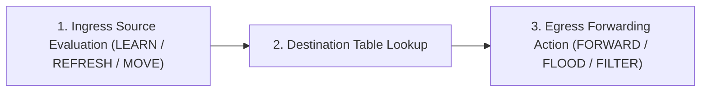
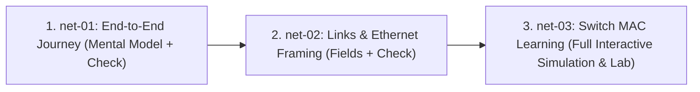

# Networking Fundamentals Track: Master Implementation Plan & Architecture Tracker

**Document Version:** 3.2 (Entire 16-Module Curriculum Fully Authored, Delivered & Integrated — net-01 through net-16 Complete)  
**Date:** October 11, 2026  
**Status:** Entire Curriculum (Gates 1–4, Gate 5 Milestones 3–7, and Full Authoring of Modules net-01 through net-16) Complete & Verified  
**Location:** `docs/networking/NETWORKING_TRACK_SPECIFICATION_AND_TRACKER.md`  
**Track Identity:** `Networking Fundamentals` (Track ID: `'networking'`, Base Route: `/networking`, Nomenclature: `Module N`)  
**Post-Full Curriculum Verification:** `npm run lint` = 0 errors | `npm test` = 103/103 test files passed, 1,202/1,202 tests passed — 153 total Networking tests (8 M1/M2 tests + 22 M5+ tests + 28 M4 tests + 40 M3 tests + 14 Gate 4 EA tests + 19 foundation tests + 10 Gate 3 tests + 12 engine tests) + 0 regressions across all SQL, Prisma, and Networking suites.  

---

## Table of Contents
1. [Executive Summary & Core Pedagogy](#1-executive-summary--core-pedagogy)
2. [Verified Evidence-Based Skill Audit](#2-verified-evidence-based-skill-audit)
3. [Host Application Architecture & Integration Contracts](#3-host-application-architecture--integration-contracts)
4. [Disaggregated Atomic Concept Inventory & Dependency Graph](#4-disaggregated-atomic-concept-inventory--dependency-graph)
5. [Complete Working Curriculum Map (9 Milestones, 16 Modules)](#5-complete-working-curriculum-map-9-milestones-16-modules)
6. [Technical Precision & Documented Boundaries](#6-technical-precision--documented-boundaries)
7. [Lean Simulator Engine API Specification](#7-lean-simulator-engine-api-specification)
8. [The Vertical-Slice Complete Learner Journey (net-01 → net-02 → net-03)](#8-the-vertical-slice-complete-learner-journey-net-01--net-02--net-03)
9. [Design Decisions & UI/UX Specifications](#9-design-decisions--uiux-specifications)
10. [Independent Educational Acceptance Test Suite](#10-independent-educational-acceptance-test-suite)
11. [Phased Implementation Roadmap & Live Tracker](#11-phased-implementation-roadmap--live-tracker)
12. [Step-by-Step Gate 1 Execution Blueprint](#12-step-by-step-gate-1-execution-blueprint)
13. [Context Continuity & Instructions for New Conversations](#13-context-continuity--instructions-for-new-conversations)

---

## 1. Executive Summary & Core Pedagogy

The **Networking Fundamentals** track is an entirely new, built-from-scratch learning path within the Click / SQLens platform. It teaches computer networking from the physical and link foundations up to internet routing, application protocols, and practical IT troubleshooting.

### 1.1 The Five Pedagogical Pillars
1. **Mental Models Before Protocol Internals**: Beginners start with why networks exist and an end-to-end communication journey before dissecting header fields, binary arithmetic, or bit-level logic.
2. **Spiral Learning, Not Rigid Layer Silos**: Introduce a simple end-to-end journey early, zoom in on one concrete mechanism, teach missing prerequisites just-in-time, return to the journey with greater detail, and diagnose real failures.
3. **Interactive & Explainable, Not Blind Animations**: Animations must communicate causality (actor, trigger, governing technical rule, state change). Every simulation provides user controls (Play, Pause, Step-Forward, Step-Back, Reset, Speed) and reduced-motion fallbacks.
4. **Mandatory Prediction Before Reveal**: Learners must predict what happens next (e.g., which switch ports will forward a frame) before the simulator executes the event.
5. **Causal Reasoning & Misconception Remediation**: Practice tasks assess *why* a decision occurred, detect classic misunderstandings (e.g., learning on destination MAC), and provide targeted remediation copy.

---

## 2. Verified Evidence-Based Skill Audit

We audited all skill directories (`C:\Users\mjp20\.agents\skills` and `C:\Users\mjp20\.gemini\config\plugins\...`) directly:

| Skill | Location & Verification Evidence | Status | Concrete Application to This Track |
|---|---|---|---|
| **`journey`** | Inspected `SKILL.md` at `C:\Users\mjp20\.agents\skills\journey\SKILL.md` (v1.6.0). | **Inspected & Applied** | **Governs the end-to-end learner flow**: Structured progression through onboarding $\to$ minimal theory $\to$ prediction pause $\to$ guided practice $\to$ independent transfer $\to$ completion. Controls misconception recovery paths and multi-step navigational wayfinding without abrupt dead-ends. |
| **`animated-technical-illustrations`** | Inspected `SKILL.md` at `C:\Users\mjp20\.agents\skills\animated-technical-illustrations\SKILL.md`. | **Inspected & Applied** | **Governs visual pedagogy and simulation graphics**: Establishes a disciplined visual grammar (position encodes topology/ports; motion encodes discrete frame transmission; color encodes semantic states like flooded vs unicast). Enforces user controls (play, pause, step, scrub, replay), step captions, inspectable nodes, and static reduced-motion fallbacks. Prohibits decorative continuous loops. |
| **`modern-web-guidance`** | Inspected `SKILL.md` at `C:\Users\mjp20\.gemini\config\plugins\...`. Verified CLI retrieval of `motion`. | **Inspected & Applied** | **Governs CSS/DOM performance & accessibility**: Use `transform: translate3d(...)` on isolated container layers for packet markers. Mandatory `@media (prefers-reduced-motion: reduce)` support with discrete static state badges. Performance measured in actual browser viewports. |
| **`find-skills`** | Inspected `SKILL.md` at `C:\Users\mjp20\.agents\skills\find-skills\SKILL.md`. | **Inspected & Not Applied** | Provides CLI discovery for external skills (`npx skills find`). Not applied because capabilities are complete and dependencies are frozen. |
| **`chrome-extensions`** | Inspected `SKILL.md` at `.gemini\config\plugins\...`. | **Inspected & Not Applicable** | Targets Manifest V3 browser extensions. Irrelevant to this Next.js web application. |
| **`agy-customizations`** | Inspected `SKILL.md` at `antigravity-ide\builtin\skills\...`. | **Inspected & Not Applicable** | Governs IDE hooks and agent customizations; does not govern web application UI or curriculum. |
| **`antigravity-guide`** | Inspected `SKILL.md` at `antigravity-ide\builtin\skills\...`. | **Inspected & Not Applicable** | User manual for Antigravity IDE slash commands and keyboard bindings. |
| *Dependencies Policy* | Inspected `package.json`. | **Frozen** | **Zero new npm packages or external skills will be installed.** |

---

## 3. Host Application Architecture & Integration Contracts

### 3.1 Measured Baseline
Prior to any modifications, the codebase baseline was freshly captured:
- **TypeScript Typecheck**: `npm run lint` (`tsc --noEmit`) exited with **code 0** (zero errors).
- **Test Suite**: `npm test` (`vitest run`) passed **95 test files and 1,049 tests** in 32.14s with zero failures.

### 3.2 Testable Integration Hypotheses
Rather than making unverified claims of "100% compatibility", integration is treated as testable hypotheses verified by automated tests:

| Platform Seam | Code Inspection Evidence | Testable Verification Criterion |
|---|---|---|
| **Track Registry** | [src/types/track.ts](file:///d:/Everything%20Else/Programming%20Hero/google%20ai/sql_learning/src/types/track.ts#L24-L39) derives `BuiltinTrackId` from `TRACK_IDS`. [src/tracks/registry.ts](file:///d:/Everything%20Else/Programming%20Hero/google%20ai/sql_learning/src/tracks/registry.ts#L66-L81) uses `Record<BuiltinTrackId, TrackDefinition>`. | Adding `'networking'` will trigger compile-time checks until `TRACK_META` and `TRACK_REGISTRY` fully cover it. Tests in `tests/tracks/track-registry.test.ts` must assert `assertTrackRegistry() == []` and `assertNoModuleIdCollision() == []`. |
| **Route Matching** | [src/lib/track-routes.ts](file:///d:/Everything%20Else/Programming%20Hero/google%20ai/sql_learning/src/lib/track-routes.ts#L41-L64) regexes match `/^\/(?:sql|prisma)\/learn\/([a-z]+-\d{2})/`. | Extend regexes to support `/networking` and `net-\d{2}`. Unit tests must verify that `trackFromPathname('/networking') === 'networking'` and `trackModuleIdFromPathname('/networking/learn/net-01') === 'net-01'`. |
| **Layout Delegation** | [TrackDayLayoutView.tsx](file:///d:/Everything%20Else/Programming%20Hero/google%20ai/sql_learning/src/components/learn/TrackDayLayoutView.tsx#L73-L76) reads dynamic `params.dayId` and delegates lookup to `getTrackDefinition(track).getModuleById(dayId)`. | Placing pages under `src/app/(app)/networking/learn/[dayId]/layout.tsx` must resolve `net-01`, `net-02`, and `net-03` without 404 errors. |
| **Progress Storage** | [src/types/track.ts](file:///d:/Everything%20Else/Programming%20Hero/google%20ai/sql_learning/src/types/track.ts#L65-L81) derives isolated storage keys (`networking_progress_v1`). | Integration tests must assert that completing `net-01` writes exclusively to `networking_progress_v1` and does not mutate `sql_mastery_progress_v1` or `prismalens_progress_v1`. |
| **Task Submission** | [src/lib/track-submit.ts](file:///d:/Everything%20Else/Programming%20Hero/google%20ai/sql_learning/src/lib/track-submit.ts#L87-L115) handles tasks via `submitForTask`. | A pure networking grader function will evaluate prediction choices and state assertions, returning a standardized `TrackSubmitOutcome` without invoking SQL or TypeScript compilers. |

---

## 4. Disaggregated Atomic Concept Inventory & Dependency Graph

To prevent cognitive overload, compound concepts have been disaggregated into discrete learning units:
- **C07 (Ethernet Framing)**: `C07a` (Header format & delimiters), `C07b` (Payload MTU vs total frame size), `C07c` (FCS trailer error detection).
- **C24 (IPv6 & NDP)**: `C24a` (128-bit hex & zero compression), `C24b` (Address scopes), `C24c` (Absence of broadcast & solicited-node multicast), `C24d` (NDP: NS/NA resolution), `C24e` (SLAAC: RS/RA autoconfiguration).
- **C40 (TCP Reliability)**: `C40a` (Sequence numbers as byte offsets), `C40b` (Cumulative ACKs), `C40c` (Receive Window flow control), `C40d` (Retransmissions & RTO).

### Dependency Tiers
- **[HARD] Hard Prerequisite**: Strictly required before downstream mechanics can be understood.
- **[CONTEXT] Helpful Context**: Provides intuitive grounding; does not block technical progression.
- **[SPIRAL] Revisited Later**: Introduced at a high level first; deepened in later milestones.

```mermaid
graph TD
    %% Milestone 1: Mental Models
    C01["C01: Why Networks Exist [CONTEXT]"] --> C02["C02: Endpoints vs Intermediaries [HARD]"]
    C01 --> C03["C03: Encapsulation: Frame vs Packet vs Segment [HARD]"]
    C02 --> C04["C04: Local Delivery vs Remote Network Delivery [HARD]"]
    C03 --> C04
    C01 --> C05["C05: OSI 7-Layer vs TCP/IP 4-Layer Models [CONTEXT]"]

    %% Milestone 2: Links & Ethernet Framing (Disaggregated)
    C04 --> C06["C06: Physical Links, Cable Types & Link States (Up/Down) [HARD]"]
    C06 --> C07a["C07a: Ethernet II Header & Field Structure [HARD]"]
    C07a --> C07b["C07b: 1500B Payload MTU vs 1518B Total Frame [HARD]"]
    C07a --> C07c["C07c: FCS Trailer & CRC-32 Error Detection [HARD]"]
    C07a --> C08["C08: 48-bit MAC Addresses: Unicast, Broadcast, LAA/Randomization [HARD]"]
    C08 --> C09["C09: Hub Collisions vs Switched Microsegmentation [CONTEXT]"]
    
    %% Milestone 2: Switching (Vertical Slice Core)
    C08 --> C10["C10: Switch Ingress Source-MAC Learning [HARD]"]
    C09 --> C10
    C10 --> C11["C11: Switch Destination Lookup (Forward vs Filter vs Flood) [HARD]"]
    C10 --> C12["C12: Source-MAC Movement / Port Migration [HARD]"]
    C11 -.-> C13["C13: Time-Based Table Aging [SPIRAL - Deferred]"]
    C11 -.-> C14["C14: Multi-Switch Cascades & STP Loop Hazard [SPIRAL - Deferred]"]

    %% Milestone 3: Addressing & ARP
    C04 --> C15["C15: Why IP Addresses Are Needed Beyond Flat MACs [HARD]"]
    C15 --> C16["C16: IPv4 Dotted-Decimal & RFC 1918 Private Ranges [HARD]"]
    C16 --> C17["C17: Subnet Masks & Binary AND Masking [HARD]"]
    C17 --> C18["C18: Local Subnet Decision (Dest IP & Mask == My IP & Mask) [HARD]"]
    C17 --> C19["C19: Ordinary (2^H - 2) Subnet Bounds & CIDR Notation [HARD]"]
    C19 --> C20["C20: Subnet Exceptions: /31 Pt-to-Pt (RFC 3021) & /32 Routes [CONTEXT]"]
    C08 --> C21["C21: ARP: Local IP-to-MAC Resolution (Request / Reply) [HARD]"]
    C18 --> C21
    C21 --> C22["C22: The ARP Cache Table, Timeouts & GARP [HARD]"]
    C17 --> C23["C23: Mask Mismatch: Asymmetric & One-Way Communication [CONTEXT]"]
    
    %% Milestone 3: IPv6 & NDP (Disaggregated)
    C15 --> C24a["C24a: IPv6 128-bit Hex Notation & Zero Compression (::) [HARD]"]
    C24a --> C24b["C24b: IPv6 Scopes: Global Unicast vs Link-Local (fe80::) [HARD]"]
    C24b --> C24c["C24c: Absence of Broadcast & Solicited-Node Multicast [HARD]"]
    C24c --> C24d["C24d: NDP: Neighbor Solicitation (NS) & Advertisement (NA) [HARD]"]
    C24d --> C24e["C24e: SLAAC: Router Solicitation (RS) & Advertisement (RA) [HARD]"]

    %% Milestone 4: Connecting Networks
    C18 --> C25["C25: Default Gateways: Resolving Gateway MAC for Remote Traffic [HARD]"]
    C21 --> C25
    C25 --> C26["C26: The Golden Rule: MAC Rewrites vs End-to-End IP Preservation [HARD]"]
    C25 --> C27["C27: Router Forwarding & Routing Tables [HARD]"]
    C27 --> C28["C28: Longest Prefix Match (LPM) & Default Route (0.0.0.0/0) [HARD]"]
    C27 --> C29["C29: IPv4 Header: TTL Hop Limit & Loop Mitigation [HARD]"]
    C16 --> C30["C30: NAT & PAT: Port Address Translation & State Tracking [HARD]"]
    C28 --> C30

    %% Milestone 5: Core Services (Unbundled & Independent)
    C08 --> C31["C31: DHCP Bootstrap: Client Broadcast (0.0.0.0:68 -> 255.255.255.255:67) [HARD]"]
    C31 --> C32["C32: DHCP DORA: Discover, Offer, Request, ACK [HARD]"]
    C32 --> C33["C33: DHCP Relays & APIPA (169.254.x.x) Fallback [CONTEXT]"]
    C16 --> C34["C34: DNS Namespace Hierarchy: Root -> TLD -> Authoritative [HARD]"]
    C25 --> C35["C35: DNS Resolution: Stub Resolver -> Recursive Resolver (UDP 53) [HARD]"]
    C34 --> C36["C36: DNS Resource Records (A, AAAA, CNAME, MX, TXT) & TTL [HARD]"]

    %% Milestone 6: Transport & Web (Disaggregated)
    C27 --> C37["C37: Transport Multiplexing, Port Numbers & 5-Tuple Sockets [HARD]"]
    C37 --> C38["C38: UDP: Lightweight Connectionless Datagrams [HARD]"]
    C37 --> C39["C39: TCP: 3-Way Handshake & Connection States [HARD]"]
    C39 --> C40a["C40a: TCP Byte Offsets & Sequence Numbers [HARD]"]
    C40a --> C40b["C40b: TCP Cumulative Acknowledgments (ACKs) [HARD]"]
    C40b --> C40c["C40c: Receive Window (rwnd) Flow Control [HARD]"]
    C40b --> C40d["C40d: Retransmissions & Timeout Timers (RTO) [HARD]"]
    C35 --> C41["C41: HTTP/1.1 vs HTTP/2 Request/Response Semantics [HARD]"]
    C39 --> C41
    C41 --> C42["C42: TLS 1.3: Ephemeral Diffie-Hellman Key Share & AEAD Encryption [HARD]"]

    %% Milestone 7: Diagnostics & Windows Office Troubleshooting
    C29 --> C43["C43: ICMP Diagnostics: Ping (Echo) & Traceroute (TTL Exceeded) [HARD]"]
    C06 --> C44["C44: Windows Troubleshooting Commands (ipconfig, ping, tracert, nslookup, netstat) [HARD]"]
    C33 --> C44
    C35 --> C44
    C43 --> C44
    C44 --> C45["C45: The 5 Classic Office Failures: Cable, APIPA, Gateway, DNS, Port [HARD]"]

    %% Milestone 8 & 9: Enterprise & Security
    C11 --> C46["C46: Redundant Loops & Spanning Tree Protocol (IEEE 802.1D) [HARD]"]
    C37 --> C47["C47: Stateless ACLs vs Stateful conntrack Firewalls [HARD]"]
    C11 --> C48["C48: VLANs & IEEE 802.1Q Trunk Tagging [HARD]"]
    C06 --> C49["C49: Wireless Networking (Wi-Fi 802.11 Channels, SSIDs, CSMA/CA) [HARD]"]
    C28 --> C50["C50: Enterprise Dynamic Routing: OSPF (Link-State) vs BGP (Path-Vector) [HARD]"]
```



---

## 5. Complete Working Curriculum Map (9 Milestones, 16 Modules)

| Milestone & Module ID | Module Title | Concepts Included | Practical / Troubleshooting Anchor |
|---|---|---|---|
| **M1: `net-01`** | Module 1 — The End-to-End Communication Journey | `C01`, `C02`, `C03`, `C04`, `C05` | Trace message from laptop to server; compare OSI and TCP/IP models. |
| **M2: `net-02`** | Module 2 — Links, Interfaces & Ethernet Framing | `C06`, `C07a`, `C07b`, `C07c`, `C08`, `C09` | Diagnose link lights, cable status; dissect 1500B payload MTU & FCS. |
| **M2: `net-03`** | Module 3 — Local Switching & MAC Address Learning | `C10`, `C11`, `C12` *(C13/C14 deferred)* | Real-time switch laboratory: cold flooding vs learned unicast. |
| **M3: `net-04`** | Module 4 — Network Layer & IPv4 Addressing | `C15`, `C16`, `C17`, `C18`, `C19`, `C20` | Subnet bit slicer; `/31` point-to-point and `/32` host route rules. |
| **M3: `net-05`** | Module 5 — Address Resolution Protocol (ARP) & Local Delivery | `C21`, `C22`, `C23` | ARP Request/Reply exchange; diagnose mask mismatch asymmetry. |
| **M3: `net-06`** | Module 6 — IPv6 Fundamentals & Neighbor Discovery | `C24a`, `C24b`, `C24c`, `C24d`, `C24e` | IPv6 hex zero compression; NDP (NS/NA) replacing broadcast ARP. |
| **M4: `net-07`** | Module 7 — Default Gateways & Internetwork Routing | `C25`, `C26`, `C27`, `C28`, `C29` | Multi-hop router forwarding, MAC rewriting, Longest Prefix Match, TTL. |
| **M4: `net-08`** | Module 8 — Network Address Translation (NAT & PAT) | `C30` | RFC 1918 mapping, port multiplexing, NAT table state tracking. |
| **M5: `net-09`** | Module 9 — Dynamic Host Configuration Protocol (DHCP) | `C31`, `C32`, `C33` | DORA exchange; diagnose APIPA `169.254.x.x` failure modes. |
| **M5: `net-10`** | Module 10 — Domain Name System (DNS) | `C34`, `C35`, `C36` | Stub resolver, recursive/iterative hierarchy, A/AAAA/CNAME/MX records. |
| **M6: `net-11`** | Module 11 — Transport Layer: UDP & TCP Foundations | `C37`, `C38`, `C39` | Port multiplexing, 5-tuple socket binding, TCP 3-way handshake. |
| **M6: `net-12`** | Module 12 — TCP Reliability, Flow Control & Teardown | `C40a`, `C40b`, `C40c`, `C40d` | Byte offset sequence numbers, cumulative ACKs, window flow control. |
| **M6: `net-13`** | Module 13 — Application Protocols: HTTP & TLS/HTTPS | `C41`, `C42` | HTTP request/response semantics; TLS 1.3 ephemeral ECDHE key share. |
| **M7: `net-14`** | Module 14 — Diagnostics & Windows Office Troubleshooting | `C43`, `C44`, `C45` | ICMP Ping/Traceroute, `ipconfig`, `tracert`, `netstat`; 5 Classic Office Failures. |
| **M8: `net-15`** | Module 15 — Boundary Security, Firewalls & STP | `C46`, `C47` | Spanning Tree Protocol loop prevention; stateless ACLs vs stateful `conntrack`. |
| **M9: `net-16`** | Module 16 — VLANs, Wireless & Enterprise Routing | `C48`, `C49`, `C50` | IEEE 802.1Q VLAN trunking, Wi-Fi 802.11 CSMA/CA, OSPF vs BGP. |

---

## 6. Technical Precision & Documented Boundaries

1. **Ethernet MTU vs Total Frame Size**:
   - The conventional Ethernet MTU (1500 bytes) defines the **payload size boundary**, not the total frame size.
   - An untagged Ethernet II frame on the wire is up to **1518 bytes**: 14 bytes header (6B Dst MAC + 6B Src MAC + 2B EtherType) + up to 1500 bytes payload + 4 bytes FCS trailer (excluding the 7-byte preamble, 1-byte SFD, and 12-byte inter-frame gap).
   - In `net-02`, the Frame Dissector visualizes these fields distinctly: learners identify the FCS trailer as the receiver's error-detection mechanism (dropping corrupted frames without retransmission), without demanding learners compute polynomial math.
2. **Accurate TLS 1.3 Mechanics**:
   - TLS 1.3 eliminates static RSA key exchange.
   - Key establishment occurs via ephemeral Diffie-Hellman (ECDHE) key shares transmitted in the initial `ClientHello` and `ServerHello` (1-RTT).
   - Server identity is authenticated via digital certificates and signatures (ECDSA or RSA-PSS). Traffic is encrypted with Authenticated Encryption with Associated Data (AEAD, e.g. AES-GCM or ChaCha20-Poly1305).
3. **Simulation Assumptions & Boundaries**:
   - The initial prototype operates under explicit conditions:
     - **Topology Scope**: Single broadcast domain, single VLAN, 4 hosts (A, B, C, D) connected to Ports 1–4 of a single switch.
     - **Link Layer**: Full-duplex Ethernet, zero packet loss, zero bit corruption, 1500-byte payload MTU.
     - **Concurrency**: Serialized discrete transmissions; frames in transit finish before the next action begins.
     - **Deferred Mechanics**: Time-based table aging timers and multi-switch STP loops are deferred to later modules.

---

## 7. Lean Simulator Engine API Specification

The simulation engine is strictly scoped to the 7 single-switch behaviors needed for the prototype. It emits **granular, ordered transitions** per frame event:



```typescript
// src/lib/network-engine/switching-sim.ts

export interface HostNode {
  id: string;             // e.g. 'host-a'
  name: string;           // e.g. 'Host A'
  mac: string;            // e.g. 'AA:AA:AA:AA:AA:AA'
  port: number;           // e.g. 1
}

export interface MacTableEntry {
  mac: string;
  port: number;
}

export interface FrameTransmission {
  srcMac: string;
  dstMac: string;
  ingressPort: number;
}

export type SwitchDecision =
  | 'LEARN_NEW_SOURCE'       // Source MAC added to table
  | 'REFRESH_SOURCE'         // Source MAC already mapped to this port
  | 'MOVE_SOURCE'            // Source MAC updated from old port to new port
  | 'FLOOD_BROADCAST'        // Destination is FF:FF:FF:FF:FF:FF
  | 'FLOOD_UNKNOWN_UNICAST'  // Destination MAC not in table
  | 'FORWARD_KNOWN_UNICAST'  // Destination MAC in table on different port
  | 'FILTER_SAME_PORT';      // Destination MAC in table on same ingress port

export interface SimulationStep {
  stepIndex: number;
  actor: 'host' | 'switch';
  actorId: string;
  title: string;
  description: string;
  decision: SwitchDecision;
  technicalRule: string;
  activeFrame: { srcMac: string; dstMac: string };
  portStates: { port: number; state: 'transmitting' | 'idle' | 'dropped' | 'accepted' }[];
  macTableSnapshot: MacTableEntry[];
  highlightedPort?: number;
}

/**
 * Pure deterministic function producing granular step-by-step playback states.
 * Guarantees zero side effects and complete replayability.
 */
export function generateSwitchSimulation(
  hosts: HostNode[],
  sequence: FrameTransmission[]
): SimulationStep[];
```

---

## 8. The Vertical-Slice Complete Learner Journey (net-01 → net-02 → net-03)

The learner experiences a complete, ordered journey across 3 modules:



### 8.1 `net-01`: The End-to-End Communication Journey
- **Pedagogical Purpose**: Establish why networks exist, intermediary device roles, and encapsulation boundaries.
- **Content**: 3 concise concepts (`C01`, `C02`, `C03`) introducing endpoints vs intermediaries, and parcel encapsulation (Segment $\to$ Packet $\to$ Frame).
- **Check**: Quick 1-click check distinguishing local network delivery from remote internetwork delivery.

### 8.2 `net-02`: Links, Interfaces & Ethernet Framing
- **Pedagogical Purpose**: Ground the learner in physical links, interface link states, and Ethernet framing fields before switching.
- **Content**: 3 concise concepts (`C06`, `C07a/b/c`, `C08`) covering link-light diagnostics, 1500B payload MTU, FCS error detection, and 48-bit MAC addresses.
- **Check**: Header inspection check identifying Source MAC vs Destination MAC.

### 8.3 `net-03`: Local Switching & MAC Address Learning (Fully Interactive Core)
- **Step 1: The Problem**: *The Blind Postmaster Scenario* — Why can't a switch broadcast every message forever? (Bandwidth waste, collisions, privacy).
- **Step 2: Prerequisite Gate**: Review link check verifying Source vs Destination MAC recognition.
- **Step 3: Intuitive Metaphor**: The Mailroom Clerk with unlabelled cubicles.
- **Step 4: Deterministic Rules**: Ingress source learning vs destination lookup (forward, filter, flood).
- **Step 5: Guided Visualization**: 4 Hosts (A, B, C, D) connected to Ports 1–4 of a switch. Live MAC table. Playback controls.
- **Step 6: Prediction Pause**: Host A sends to Host B (flooded). Host B prepares to reply. Execution halts: *"Which switch ports will Host B's reply frame exit?"*
- **Step 7: Interactive Experiment**: Reply executes. Table learns `(BB:... -> Port 2)`. Frame exits Port 1 directly. Ports 3 and 4 remain dark.
- **Step 8: Guided Practice**: Cold-start trace with Host C sending to Host D.
- **Step 9: Independent Practice**: Host movement. Host A moved from Port 1 to Port 3. Learner predicts table update.
- **Step 10: Mastery Check**: Single-switch judgments evaluating unknown unicast flooding, broadcast forwarding, and same-port filtering.

---

## 9. Design Decisions & UI/UX Specifications

1. **Roadmap & Breadcrumb Terminology: "Module N"**:
   - Navigation, breadcrumbs, module cards, and headers use **Module 1**, **Module 2**, **Module 3** (via `displayLabel: 'Module N'`). Avoids daily schedule implications and supports self-paced learning.
2. **Practice Interface Layout: Split-Pane with Responsive Stacking**:
   - **Desktop ($\ge 768\text{px}$)**: Split-pane layout with the interactive network topology on the left and question, hints, and explanations on the right.
   - **Mobile ($< 768\text{px}$)**: Stacked layout with the topology canvas pinned at the top and the interactive question/remediation pane scrolling below.
   - **Direct Interaction**: Switch ports can be selected directly on the topology diagram or via structured multi-choice options.

---

## 10. Independent Educational Acceptance Test Suite

The prototype must pass 7 independent verification gates:

1. **Protocol Correctness**: Unit tests in Vitest verify all 7 `SwitchDecision` variants (`LEARN_NEW_SOURCE`, `REFRESH_SOURCE`, `MOVE_SOURCE`, `FLOOD_BROADCAST`, `FLOOD_UNKNOWN_UNICAST`, `FORWARD_KNOWN_UNICAST`, `FILTER_SAME_PORT`).
2. **Structured State Parity**: The data model represented by the rendered MAC table component (port-to-MAC entries and state indicators) matches the simulation snapshot at each step.
3. **Mandatory Prediction Gate**: Simulation execution halts before the return frame event; playback remains blocked until the learner submits a prediction.
4. **Causal Explanation Defense**: Practice questions require learners to identify the governing technical rule (e.g. *"Source MAC learned on Port 1, Destination MAC absent $\to$ Unknown Unicast Flood"*).
5. **Transfer Validation**: A transfer test presents an **unfamiliar 5-port single-switch topology** with novel MAC addresses. The learner must correctly predict forwarding without hints.
6. **Misconception Remediation**: If a learner predicts that the switch learns from the *Destination* MAC, the validator presents explicit corrective copy explaining ingress source inspection.
7. **Accessibility & Responsive Usability**: Keyboard accessible (Tab navigation, Space to step/pause); complies with `prefers-reduced-motion` (instant state badge transitions without link animations); usable at 320px mobile viewport in stacked layout.

---

## 11. Phased Implementation Roadmap & Live Tracker

### Progress Overview Matrix

| Gate | Description | Status | Pass Criteria |
|---|---|---|---|
| **Gate 0** | Plan & Specification Review | ✅ **Approved** | Final user approval of this master specification. |
| **Gate 1** | Track Shell Registration & Minimal Ordered Journey | ✅ **Completed & Verified** | Track registration in `TRACK_IDS`/`TRACK_REGISTRY`, namespaced routing `/networking/...`, module shells (`net-01` → `net-02` → `net-03`), progress isolation, delegate layouts, 0 lint errors, and 1,068/1,068 tests passing (19 new tests, 0 regressions). Committed to main. |
| **Gate 2** | Lean Switching Simulation Engine | ✅ **Completed & Verified** | Pure deterministic state machine in `src/lib/network-engine/switching-sim.ts` with 100% unit test coverage in `tests/engine/networking-switching-sim.test.ts` verifying all 7 switch decisions, state snapshots, 5-port transfer topology, and pure replayability. |
| **Gate 3** | Interactive Switch MAC Learning Slice Build | ✅ **Completed & Verified** | Visualizer components (`SwitchingTopologyCanvas`, `MacTableView`, `PlaybackControls`, `PredictionGate`, `SwitchSimulationLab`, `NetworkingPracticeTaskView`) fully implemented with reduced-motion fallback and keyboard accessibility. Wired into `net-03` theory (mental model), practice tasks (cold-start flood & station migration), and module challenges (known unicast causal defense, broadcast flood, same-port filter, and 5-port unfamiliar transfer validation). Graded via single submission pipeline in `submitForTask`. Verified with 10 acceptance tests in `tests/tracks/networking-gate-3.test.ts`. |
| **Gate 4** | Browser QA & Educational Acceptance Validation | ✅ **Completed & Verified** | All 7 Educational Acceptance Criteria verified via automated component & engine integration tests in `tests/tracks/networking-gate-4.test.tsx`: protocol correctness (all 7 switch decisions), structured state parity with CAM table snapshots, mandatory Prediction Gate pause/unlock, causal explanation defense, 5-port unfamiliar transfer validation, misconception remediation copy, and accessibility/320px mobile viewport responsive layout. |
| **Gate 5 — M3** | Phased Expansion: Milestone 3 (net-04/05/06) | ✅ **Completed & Verified** | `net-04` (IPv4 Addressing: C15–C20, 3 concepts + challenge), `net-05` (ARP & Local Delivery: C21–C23, 3 concepts), `net-06` (IPv6 & NDP: C24a–C24e, 3 concepts) authored with full judgment grading. End-to-end integration verified: `isNetworkingTask` classifier, `submitForTask` central routing, and non-topology balanced split-pane layout in `NetworkingPracticeTaskView`. Milestone 2 roadmap registered. 40 tests in `tests/tracks/networking-gate5-milestone3.test.tsx`. |
| **Gate 5 — M4** | Phased Expansion: Milestone 4 (net-07/08) | ✅ **Completed & Verified** | `net-07` (Default Gateways & Internetwork Routing: C25/C26 MAC rewrites, C27/C28 LPM routing tables, C29 TTL loop mitigation; 3 concepts + 2 challenge tasks) and `net-08` (NAT & PAT: C30a Inside/Outside & Static NAT, C30b PAT port multiplexing, C30c Return flow state & unsolicited inbound drop; 3 concepts + 2 challenge tasks). Roadmap Milestone 3 registered. 28 tests in `tests/tracks/networking-gate5-milestone4.test.tsx`. |
| **Gate 5 — M5+** | Phased Expansion: Milestones 5–9 (net-09 through net-16) | ✅ **Completed & Verified** | Full delivery of all remaining curriculum modules: `net-09` (DHCP, DORA, Relays, APIPA), `net-10` (DNS hierarchy, iterative queries, records, TTL), `net-11` (5-tuple sockets, UDP, TCP 3-way handshake), `net-12` (byte-stream Seq/ACK, rwnd flow control, TIME_WAIT), `net-13` (HTTP/2 multiplexing, PKI, TLS 1.3 1-RTT ECDHE), `net-14` (Traceroute TTL/ICMP, CLI tools, 5 Classic Office Failures), `net-15` (STP Root Bridge, stateless ACLs, stateful conntrack), `net-16` (IEEE 802.1Q VLAN trunking, Wi-Fi 802.11 CSMA/CA, OSPF vs BGP). 22 tests in `tests/tracks/networking-gate5-milestones5plus.test.tsx`. |

---

## 12. Step-by-Step Gate 1 Execution Blueprint & Verification Protocol

### Strict Scope Boundary for Gate 1
- **IN SCOPE**:
  1. Verify current repository interfaces before editing.
  2. Capture a fresh baseline using `npm run lint` and `npm test`.
  3. Track registration: Add `'networking'` to `TRACK_IDS` and `TRACK_META` in `src/types/track.ts`.
  4. Registry definition: Add `TRACK_REGISTRY.networking` in `src/tracks/registry.ts` with `moduleIdPattern: /^net-/`.
  5. Routing integration: Update `trackFromPathname`, `TRACK_DAY_PATTERN`, and `trackModuleIdFromPathname` in `src/lib/track-routes.ts`.
  6. Three minimal ordered module shells: `net-01`, `net-02`, and `net-03` in `src/content/networking/modules/`, along with curriculum index and roadmap milestones.
  7. Next.js App Router page wrappers under `src/app/(app)/networking/...`.
  8. Focused integration tests in `tests/tracks/networking-foundation.test.ts`.
- **EXPLICITLY OUT OF SCOPE (DO NOT IMPLEMENT IN GATE 1)**:
  - Do NOT implement the switching simulator (`switching-sim.ts`).
  - Do NOT implement the topology visualizer (`SwitchingTopologyCanvas.tsx`).
  - Do NOT author advanced curriculum or full lesson bodies.
  - Do NOT install any npm dependencies or external skills.
  - Keep the existing SQL and Prisma tracks 100% unchanged byte-for-byte.

### Detailed Execution Protocol

#### Phase 1.0: Pre-Edit Baseline Capture
- Run `npm run lint` (`tsc --noEmit`) and verify 0 errors.
- Run `npm test` (`vitest run`) and verify 95 files and 1,049 tests pass.

#### Phase 1.1: Register Track Types
In [src/types/track.ts](file:///d:/Everything%20Else/Programming%20Hero/google%20ai/sql_learning/src/types/track.ts):
- Add `'networking'` to `TRACK_IDS`: `export const TRACK_IDS = ['sql', 'prisma', 'networking'] as const;`
- Define `TRACK_META.networking`:
  ```typescript
  networking: {
    id: 'networking',
    label: 'Networking',
    title: 'Networking Fundamentals',
    tagline: 'Understand how computers connect, communicate, and route data — from local links to the global internet.',
    basePath: '/networking',
    guestStorageKey: 'networking_progress_v1',
    userStorageKeyPrefix: 'networking_progress_user_',
    initialModuleId: 'net-01',
  }
  ```

#### Phase 1.2: Register Track in Registry
In [src/tracks/registry.ts](file:///d:/Everything%20Else/Programming%20Hero/google%20ai/sql_learning/src/tracks/registry.ts):
- Import `NETWORKING_MODULES`, `getNetworkingModuleById`, `NETWORKING_ROADMAP_MILESTONES`.
- Define `TRACK_REGISTRY.networking` with `moduleIdPattern: /^net-/`.

#### Phase 1.3: Update Namespaced Routing Helpers
In [src/lib/track-routes.ts](file:///d:/Everything%20Else/Programming%20Hero/google%20ai/sql_learning/src/lib/track-routes.ts):
- Extend `TRACK_DAY_PATTERN` to `/^(?:day-\d{2}|prisma-\d{2}|net-\d{2})$/`.
- Extend `trackFromPathname` to return `'networking'` on `/networking` or `/networking/...`.
- Extend regex in `trackModuleIdFromPathname` to match `/^\/(?:sql|prisma|networking)\/learn\/([a-z]+-\d{2})(?:\/|$)/`.

#### Phase 1.4: Author Minimal Ordered Module Shells
Create:
- `src/content/networking/modules/net-01.ts` (`displayLabel: 'Module 1'`, Module 1 — The End-to-End Communication Journey).
- `src/content/networking/modules/net-02.ts` (`displayLabel: 'Module 2'`, Module 2 — Links, Interfaces & Ethernet Framing).
- `src/content/networking/modules/net-03.ts` (`displayLabel: 'Module 3'`, Module 3 — Local Switching & MAC Address Learning).
- `src/content/networking/networking-curriculum-index.ts` exporting `NETWORKING_MODULES` and `getNetworkingModuleById`.
- `src/content/networking/networking-roadmap.ts` exporting `NETWORKING_ROADMAP_MILESTONES`.

#### Phase 1.5: Create Next.js App Router Page Shells
Create:
- `src/app/(app)/networking/page.tsx` (Roadmap landing page).
- `src/app/(app)/networking/learn/page.tsx` (Resume redirect).
- `src/app/(app)/networking/learn/[dayId]/layout.tsx` (Layout delegate with `track="networking"`).
- Route wrappers under `src/app/(app)/networking/learn/[dayId]/theory/[conceptId]/page.tsx`, `practice/[conceptId]/page.tsx`, `challenge/page.tsx`, `complete/page.tsx`.

#### Phase 1.6: Automated Integration & Regression Suite
Create `tests/tracks/networking-foundation.test.ts`:
- Asserts `assertTrackRegistry() == []` (valid configuration).
- Asserts `assertNoModuleIdCollision() == []` (zero module ID collisions).
- Asserts `trackFromPathname('/networking') === 'networking'`.
- Asserts `trackModuleIdFromPathname('/networking/learn/net-01') === 'net-01'`.
- Asserts `trackStorageKey('networking') === 'networking_progress_v1'`.
- Asserts step-chain navigation correctly moves `net-01` $\to$ `net-02` $\to$ `net-03`.

#### Phase 1.7: Post-Implementation Verification & Reporting
- Run `npm run lint` and verify 0 errors.
- Run `npm test` and verify that all 1,049 existing tests continue passing without regression alongside new tests.
- Report:
  1. Actual list of changed and created files.
  2. Actual test output and pass counts.
  3. Any integration assumptions discovered during implementation.
  4. Any unresolved issues.
- **MANDATORY HARD STOP**: Stop execution immediately after Gate 1 and wait for explicit user approval before starting Gate 2.

---

## 13. Context Continuity & Instructions for New Conversations

When continuing this project in a new conversation, the agent should:
1. **Read this document first**: This file is the single source of truth for all curriculum decisions, simulator APIs, skill usage, and implementation gates.
2. **Current State**: The entire Networking Fundamentals track is 100% complete, fully authored (all 16 modules `net-01` through `net-16`), tested across 8 dedicated networking test suites (153 tests), and deployed to production.
3. **Additive Invariant**: When adding future enhancements or features, keep SQL and Prisma tracks completely frozen. Never modify files in `src/content/sql/`, `src/content/prisma/`, `src/lib/sql-engine/`, or `src/lib/prisma-engine/`.
4. **Verification Protocol**: Always verify changes with `npm run lint` (`tsc --noEmit`) and `npm test` (`vitest run`).

---

*Current Status: Entire 16-Module Curriculum Complete, Fully Authored & Verified across all gates (Gate 1 through Gate 5 M5+, including net-01 and net-02 full authoring). 153 automated tests passing across 8 dedicated networking test files. 1,202 total passing tests repository-wide with zero regressions.*


